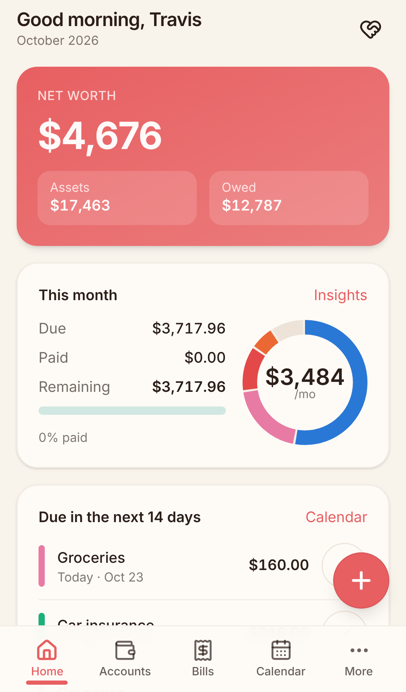
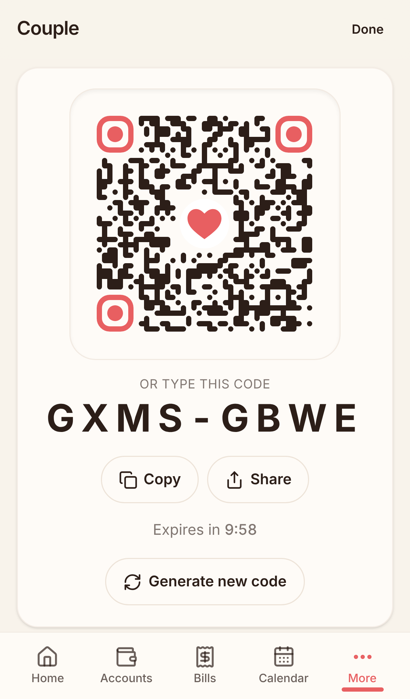
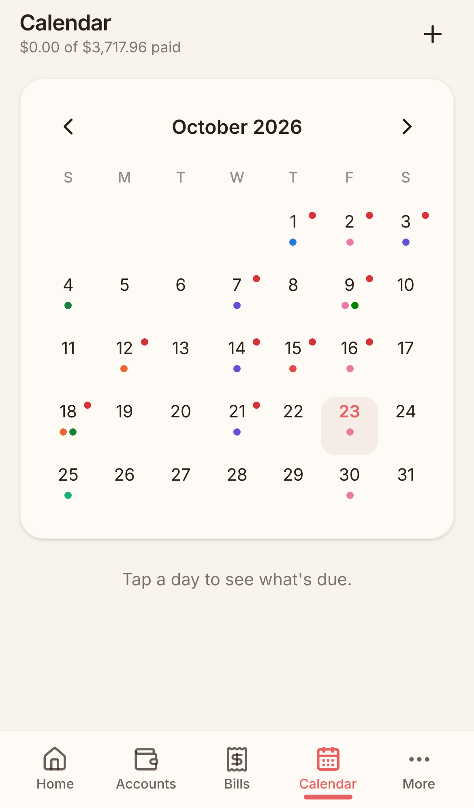
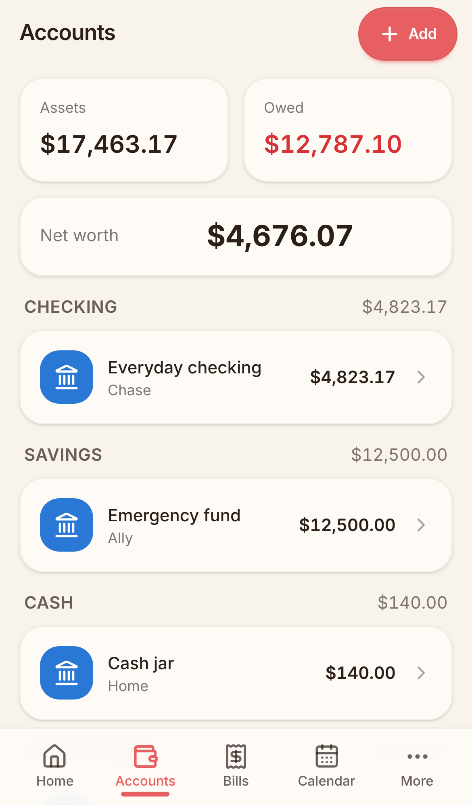
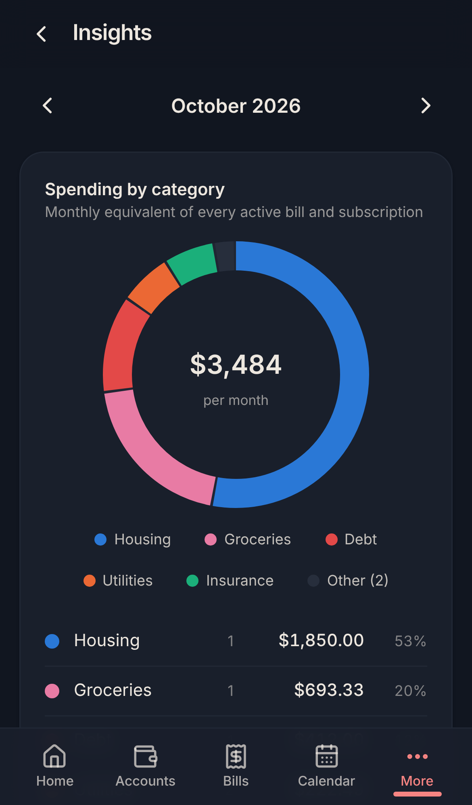

# CouplesCash

**Shared money at a glance, for exactly two people.** CouplesCash is a
mobile-first PWA that replaces the "notes app → screenshot → text message"
ritual with one private dashboard: every bank balance, every bill and
subscription, a calendar of what is due, and a pie chart of where the money
goes. It runs on a Raspberry Pi in your closet, reachable from anywhere through
a Cloudflare Tunnel — no port forwarding, no app store, no third-party service
ever sees your numbers (the one optional exception is a $1.50/month
[SimpleFIN Bridge](https://beta-bridge.simplefin.org) link, if you choose to
have balances and transactions pulled in instead of typing them).

<p align="center">
  
  
  
  
  
</p>

## Features

- **Couple Code** linking: a styled QR with a heart in the middle (or an 8-character code to type); 10-minute expiry, single use.
- **Accounts**: checking, savings, credit, cash, investment, loan — balances with history sparkline, typed in or synced from your bank.
- **Bills, subscriptions, income** with real recurrence (weekly → yearly, month-end clamping), mark occurrences paid, monthly-equivalent totals.
- **Calendar** of everything due, **Dashboard** with net worth and "due in the next 14 days", **Insights** donut by category.
- **Push reminders** (v2): "Electric is due tomorrow · $142.50" on both phones N days before, at your hour, in your household's time zone; optional partner-activity pushes. Web Push with VAPID keys generated on your Pi — no third-party notification service. [docs/NOTIFICATIONS.md](docs/NOTIFICATIONS.md)
- **Autopay auto-mark** (v2): bills your bank pays automatically mark themselves paid on the due date, with an **Undo**.
- **Activity feed** (v2): every change says who did it — "Kaylee marked Rent paid · 2h ago".
- **Expenses & budgets** (v2): one-off spending per category, monthly budgets with progress bars, over-budget flags.
- **Pay-period view** (v2): weekly / biweekly / twice-monthly / monthly — "Until payday (Fri Nov 6)": expected income, due, paid, spendable.
- **Savings goals** (v2): linked to a savings account or manual, with a projected completion date and "needed per month".
- **Month-close report** (v2): one shareable card (PNG via Web Share, or print to PDF) that replaces the screenshot.
- **To-pay checklist** (v2): shared list for the things that aren't bills — "Transfer $200 to savings".
- **Household settings** (v2): currency, week start, default account, time zone, pay period.
- **Passkeys** (v2): sign in with Face ID / fingerprint (WebAuthn, discoverable credentials); password stays as fallback. [docs/PASSKEYS.md](docs/PASSKEYS.md)
- **Bank sync** (v3): link your banks through [SimpleFIN Bridge](https://beta-bridge.simplefin.org) — read-only, flat $1.50/month, built for self-hosters. Balances and transactions arrive every 6 hours (or *Sync now*); credentials stay encrypted on the Pi. [docs/BANK-SYNC.md](docs/BANK-SYNC.md)
- **CSV import** (v3): for banks the Bridge can't reach — pick a file, map columns (signed amount or debit/credit), duplicates are skipped.
- **Review inbox** (v3): every imported transaction gets a suggestion — a category, a bill it pays ("Rent · due Nov 1", marks it paid), or "transfer" — and you confirm, ignore or bulk-confirm. Payees you've confirmed once are matched automatically next time, with Undo.
- **Installable PWA** on iOS Safari and Android Chrome; light/dark follows the device.
- **Secure by default**: Argon2id, 15-minute JWTs with rotating refresh tokens, household-scoped SQL, rate limiting, strict headers, non-root read-only containers, API never exposed to the internet. See [docs/SECURITY.md](docs/SECURITY.md).
- **Pi-sized**: the whole stack idles at ~300 MB RAM; prebuilt `arm64` images from GHCR.

## Architecture

```
            ┌──────────────┐   HTTPS (Cloudflare Tunnel)
 phones ───▶│  cloudflared │──────────────┐
            └──────────────┘              ▼
                                   ┌──────────────┐  server-side fetch   ┌──────────────┐      ┌────────────┐
                                   │  web (Kit)   │ ───────────────────▶ │  api (.NET)  │ ───▶ │  postgres  │
                                   │  :3000       │   http://api:8080    │  :8080       │      │  :5432     │
                                   └──────────────┘                      └──────────────┘      └────────────┘
                                   BFF: owns the httpOnly cookies         JWT bearer auth,       only on the
                                   and talks to the API on the            household-scoped       internal network
                                   internal docker network                SQL, rate limits
```

| Layer | Tech |
|---|---|
| Web | SvelteKit 2 · Svelte 5 runes · TypeScript · Tailwind 4 + daisyUI 5 · adapter-node · Playwright |
| API | .NET 10 Minimal APIs · Npgsql + Dapper · DbUp migrations · Scalar docs · xunit |
| Data | PostgreSQL 16 |
| Edge | cloudflared (tunnel) · optional Cloudflare Access |
| Ops | Docker Compose · Makefile · GitHub Actions → multi-arch images on GHCR |

The API contract between web and api is [docs/API-CONTRACT.md](docs/API-CONTRACT.md); the build plans are [docs/PLAN.md](docs/PLAN.md), [PLAN-V2](docs/PLAN-V2.md) and [PLAN-V3](docs/PLAN-V3.md). The only outbound connections the stack makes are to Cloudflare (tunnel), the push services (if enabled) and — only if you link a bank — the SimpleFIN Bridge.

## Quick start (development on Linux)

Prereqs: Docker (with the compose plugin), .NET 10 SDK, Node 22, pnpm 10.

```bash
git clone https://github.com/tahuffman1s/CouplesCash.git && cd CouplesCash
make setup      # checks tools, creates .env with fresh secrets, restores deps
make dev        # Postgres in Docker; API (dotnet watch) + web (vite) natively
```

`make setup` runs `make secrets`, which generates `JWT_SECRET`, `POSTGRES_PASSWORD` and
`DATA_KEY` (bank-sync encryption key) and the Web Push (VAPID) key pair (`make vapid`, via
`dotnet run -- --vapid`); without the VAPID keys push is simply disabled, without `DATA_KEY`
bank sync is.
Passkeys work on `http://localhost` without TLS.

Open <http://localhost:5173>. API docs at <http://localhost:8080/scalar>.
Ctrl-C stops api + web; `make down` stops the database. Everything else:
`make help`.

VS Code: open `CouplesCash.code-workspace`, install the recommended
extensions, press F5 → **Full stack** (debugs the API, runs the web dev server).
A `.devcontainer` is included if you prefer a container.

## Deploy to a Raspberry Pi 4 (or any 64-bit Linux box)

One line. It installs Docker and the compose plugin for your distro, clones the repo to
`~/couplescash`, generates secrets, asks for your public URL and Cloudflare tunnel token,
pulls the arm64/amd64 images and starts everything:

```bash
curl -fsSL https://raw.githubusercontent.com/tahuffman1s/CouplesCash/main/install.sh | bash
```

Supported: Raspberry Pi OS (64-bit), Debian, Ubuntu, Fedora, RHEL/Rocky/Alma, Arch, Alpine,
openSUSE. Re-run the same line later to update. Non-interactive example:

```bash
curl -fsSL https://raw.githubusercontent.com/tahuffman1s/CouplesCash/main/install.sh \
  | bash -s -- -y --public-url https://cash.example.com --tunnel-token "$TUNNEL_TOKEN"
# force Raspberry Pi mode (auto-detected on real Pi hardware; adds zram swap, NTP check, pull-only):
#                                  | bash -s -- --pi
# home-network only, no tunnel:   | bash -s -- -y --lan
# just install + configure:       | bash -s -- --no-start
```

Then: open your URL on phone 1 → **Register**; phone 2 → Register → **Couple** → scan phone 1's
Couple Code; Settings → **Install app** on both, then (from the installed app) Settings →
**Notifications** and **Passkeys**. The installer generates the VAPID keys for push;
`make vapid` does the same later. Full guide with troubleshooting:
[docs/RASPBERRY-PI.md](docs/RASPBERRY-PI.md). Tunnel setup: [infra/cloudflared/README.md](infra/cloudflared/README.md).

## Project layout

```
CouplesCash/
├─ apps/
│  ├─ api/                   .NET 10 solution (CouplesCash.Api, CouplesCash.Api.Tests, Dockerfile)
│  └─ web/                   SvelteKit app (src/routes, src/lib, e2e, static, Dockerfile)
├─ infra/
│  ├─ cloudflared/README.md  Tunnel + Access setup
│  └─ postgres/postgresql.conf   Pi-tuned Postgres config
├─ install.sh                one-line installer (any 64-bit Linux / Pi); generates secrets + VAPID keys
├─ scripts/                  dev.sh · dev-env.sh · backup.sh (DB dump + .env copy)
├─ docs/                     PLAN · PLAN-V2 · PLAN-V3 · API-CONTRACT · RASPBERRY-PI · SECURITY · NOTIFICATIONS · PASSKEYS · BANK-SYNC
├─ .vscode/ · .devcontainer/ · .github/
├─ compose.yml               db · migrate · api · web (· cloudflared via --profile tunnel)
├─ compose.dev.yml           publishes db on 127.0.0.1:5432 for native dev
├─ Makefile                  make help
├─ .env.example              every variable, documented
└─ CLAUDE.md                 cheat-sheet for coding agents
```

## Documentation

- [Build plan](docs/PLAN.md) · [v2 plan](docs/PLAN-V2.md) · [v3 plan](docs/PLAN-V3.md) · [API contract](docs/API-CONTRACT.md)
- [Raspberry Pi guide](docs/RASPBERRY-PI.md) · [Cloudflare Tunnel](infra/cloudflared/README.md)
- [Bank sync, CSV import & inbox](docs/BANK-SYNC.md) · [Push notifications](docs/NOTIFICATIONS.md) · [Passkeys](docs/PASSKEYS.md)
- [Security](docs/SECURITY.md)
- [CLAUDE.md](CLAUDE.md) — conventions for humans and agents

## Licence

[MIT](LICENSE) © 2026 Travis Huffman
